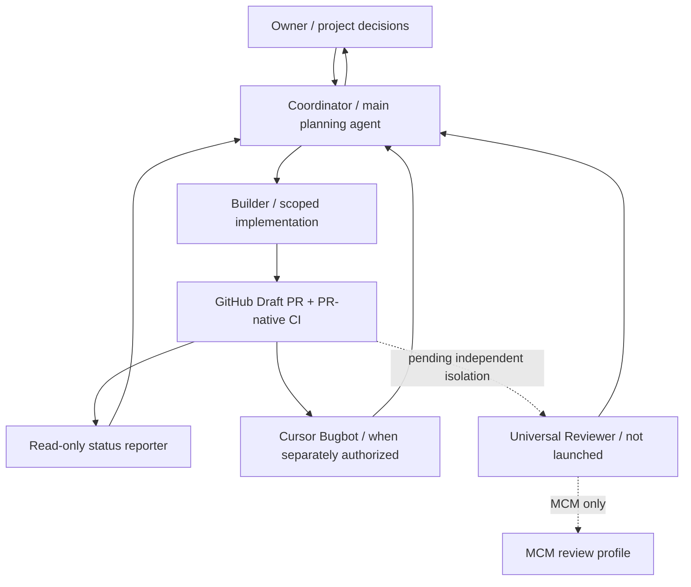

# MCM Development Agent Registry

> **This describes the DEVELOPMENT orchestration, not the LangGraph research agents inside the product.** A role prompt is **not** a running Cloud Agent; a Cursor Cloud conversation is a run, not a permanent role; a GitHub Action is not an independent AI reviewer.

Machine-readable role definitions: [agent-registry.json](agent-registry.json). Task inventory: [task-registry.json](task-registry.json). Operating procedure: [COORDINATOR_RUNBOOK.md](COORDINATOR_RUNBOOK.md).

## One project, explicit hierarchy

## Roles and reality

| Role | Runtime | Responsibility | Verified reality |
| --- | --- | --- | --- |
| Coordinator | ChatGPT + GitHub, with Cursor Projects integration **not validated** | Scope, dispatch decisions, status, owner handoff | Coordinator work is human-assisted |
| Builder | Cursor main Cloud Agent / supported `generalPurpose` | Code, tests, one owned Draft PR | Pilot only, not continuous dispatch |
| CI + Read-only Status | GitHub Actions | Objective tests and report | Evidence exists on PR #18 earlier HEAD |
| Cursor Bugbot | Cursor review service | Flag code defects | Review of PR #16 old SHA exists; not the fix SHA |
| Universal Reviewer | Proposed restricted Cloud Agent | Independent review of exact PR diff | **BLOCKED:** prompt exists, separate read-only principal does not |
| MCM Review Profile | File rules, not an agent | Modeling/statistics review requirements | Configured, not executed |

## How to trace a task

Find `task_id` in [task-registry.json](task-registry.json). Follow `issue` → `branch` → `pr` → exact HEAD/checks → `session` (if recorded) → `next_gate`. A `null` session is intentional; do **not** invent a Cursor Cloud URL. Session links are historical run records and do not create an always-running role.

The registry is a **manual bootstrap inventory**, NOT a live synchronized dashboard. Live engineering truth stays in GitHub. Use [COORDINATOR_RUNBOOK.md](COORDINATOR_RUNBOOK.md) to update snapshots after handoffs, and do not pretend a cached status is real-time.

## Cost and permission boundary

Owner allows **$0 additional billed spend**. Any new Cursor Cloud call, Automation or externally billed review requires separate explicit approval. No unattended paid dispatch, no secret/billing changes, no main branch changes and no merge. The two-fix controller only limits actions routed through that controller. A GitHub read-only job cannot enforce write restrictions on a different Cursor session.

## Development agents vs product agents

- **Development agents** build the MCM software and are listed here.
- **Product agents** belong to the MCM application and may use LangGraph to perform problem understanding, EDA, modeling, coding and paper drafting. Their runtime state and research checkpoints must be inspected separately before changing modeling logic.
